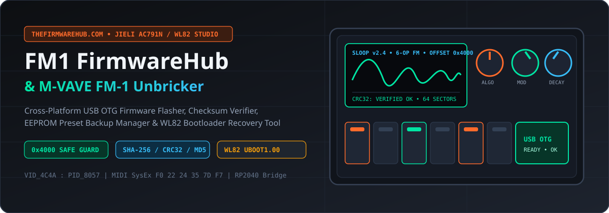
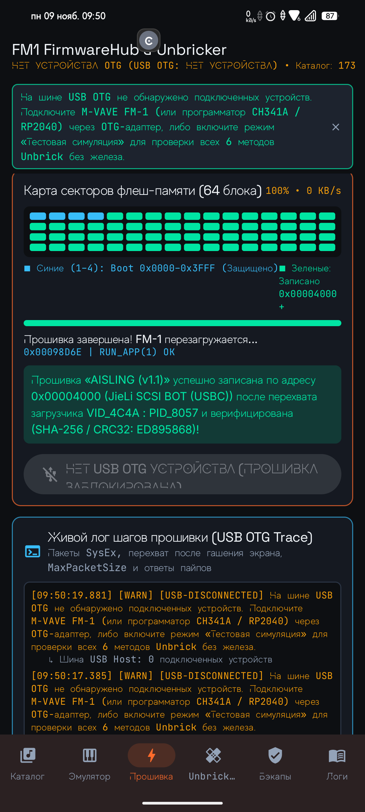
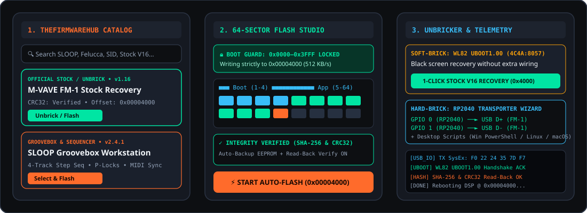
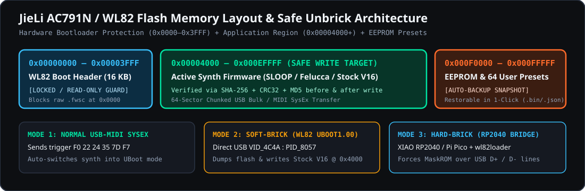

<div align="center">

# 🎛️ FM1 FirmwareHub & M-VAVE FM-1 Unbricker Studio

**Cross-Platform Firmware Catalog (`TheFirmwareHub.com`), Direct USB OTG Flasher, Cryptographic Checksum Verifier, EEPROM Preset Backup Manager & JieLi WL82 Unbricker for the M-VAVE FM-1 Synthesizer**

[-FF6B2B?style=for-the-badge)](#)
[](#)
[](#)
[](#)
[-10B981?style=for-the-badge)](releases/FM1-FirmwareHub-Unbricker-v6.4-bilingual-otg-flasher-debug.apk)



<br />

### 📦 [Download Latest Android APK (v6.4)](releases/FM1-FirmwareHub-Unbricker-v6.4-bilingual-otg-flasher-debug.apk)
*SHA-256:* `debfbe4f3ffb6d05be354e4b6bca7e00449a862173aa1cd692a30a9a4271e04d` • *Size:* ~28.0 MB • [Release Notes](releases/RELEASE_NOTES.md)

<br />

**[🇬🇧 English Documentation](#-english-documentation)** • **[🇷🇺 Документация на русском языке](#-документация-на-русском-языке)**

</div>

---

# 🇬🇧 English Documentation

## 📖 Overview

**FM1 FirmwareHub & M-VAVE FM-1 Unbricker Studio** is a dedicated mobile and desktop engineering utility built for musicians and developers using the **M-VAVE FM-1 (M-Wave FM1)** portable FM synthesizer powered by the **JieLi AC791N / WL82** processor architecture.

The synthesizer community around **[TheFirmwareHub.com](https://thefirmwarehub.com/)** has published dozens of transformative open-source firmwares (*SLOOP Groovebox*, *sloopDX*, *Felucca*, *OberVave*, *FM-1 SID*, *FM1-TRAX*, *Mutable Dreams*, *Baud Girl*, *JIANT FM*). However, flashing custom builds historically required desktop terminal scripts or could cause soft-bricks (`WL82 UBOOT1.00`) if sectors were incorrectly addressed.

This application provides a **complete, standalone mobile workstation**: plug your M-VAVE FM-1 directly into your Android smartphone via a standard USB-C OTG cable, browse 170+ community firmwares, back up your user presets, and flash safely with hardware bootloader protection in seconds.

---

## 📸 Screenshots & Live Hardware Demonstration

<div align="center">

### 📱 Live USB OTG Flash in Action (Real Device Test)

<table>
  <tr>
    <td align="center" width="45%">
      
      <br />
      <b>⚡ Real Device USB OTG Flasher</b>
      <br />
      <sub>64-Sector Memory Grid (100% written), Bootloader Guard (0x4000+), Live Trace & Automatic <code>RUN_APP(1)</code> Reboot</sub>
    </td>
    <td align="center" width="55%">
      
      <br />
      <b>🧩 Studio Architecture: Catalog, 64-Sector Flasher & Unbricker</b>
      <br />
      <sub>Full bilingual workflow with safety verification and EEPROM preservation</sub>
    </td>
  </tr>
</table>

</div>

<br />

<div align="center">
  
</div>

---

## ✨ Key Features

1. **🌐 Dual-Language Support (English 🇬🇧 / Russian 🇷🇺)**:
   - One-click language switcher chip located directly in the `TopAppBar`.
   - Full localization across all navigation tabs, category chips, sorting menus, modal sheets, and system status banners.
2. **⚡ Direct Phone-to-Synth USB OTG Flasher (No PC Bridge Required)**:
   - Operates entirely over a standard USB-C to USB-C / OTG cable connected to your Android phone.
   - Built-in official **JieLi AC791N SRAM loader (`wl82loader.bin`)** injected into `0x01C02000`.
   - Atomic execution session prevents device watchdog timeouts (5-6s timer) when the FM-1 screen blanks.
   - Page-by-page writing (512-byte blocks) verified with **JieLi CRC-CCITT** (`0x1021`) and post-flash read-back.
3. **🛡️ Hardware Bootloader Guard (`0x0000–0x3FFF LOCKED`)**:
   - Strictly enforces writing firmware to offset **`0x00004000`**, safeguarding the 16 KB JieLi boot header and preventing permanent bricking.
4. **🔍 TheFirmwareHub Online & Offline Catalog**:
   - Instant search across 170+ community firmwares with filtering by synthesis category (*FM Synth*, *Groovebox*, *Chiptune*, *Virtual Analog*, *Ambient*, *Official Stock*).
   - Clean, direct binary downloads without restrictive network headers.
5. **🔒 Triple Cryptographic Verification**:
   - Real-time pre-flash calculation of **SHA-256**, **CRC32**, and **MD5** hashes.
6. **💾 EEPROM Preset Backup & Restore**:
   - 1-click snapshot of your 64 user patches and boot headers prior to flashing.
7. **🚑 Dedicated Soft-Brick & Hard-Brick Unbricker Studio**:
   - **Soft-Brick 1-Click Recovery**: Direct rescue for synthesizers showing a black screen and enumerating as `WL82 UBOOT1.00` (`VID_4C4A : PID_8057`).
   - **Hard-Brick RP2040 Transporter Bridge**: Interactive 4-step wizard for unbricking using a Seeed XIAO RP2040 or Raspberry Pi Pico wired to USB `D+ / D-`.

---

## 🎹 Bundled & Supported Firmwares (`TheFirmwareHub.com`)

| Firmware Name | Category | Version | Target Offset | Highlights |
| :--- | :--- | :--- | :--- | :--- |
| **M-VAVE FM-1 Official Stock V16** | `OFFICIAL_STOCK` | `v1.16` | `0x00004000` | Factory baseline recovery image for Soft-Brick (`WL82 UBOOT1.00`) |
| **SLOOP Groovebox Workstation** | `GROOVEBOX` | `v2.4.1` | `0x00004000` | 4-track polyphonic step sequencer, parameter locks, song mode |
| **sloopDX 6-Operator FM** | `FM_SYNTH` | `v1.9.0` | `0x00004000` | Classic 6-op DX7 engine with USB-MIDI `.SYX` patch bank import |
| **Felucca FM & Arpeggiator** | `FM_SYNTH` | `v3.1.2` | `0x00004000` | TX81Z multi-waveform 4-op FM with Euclidean arpeggiator |
| **OberVave Virtual Analog** | `VIRTUAL_ANALOG` | `v1.5.4` | `0x00004000` | 80s virtual analog polysynth with unison detune & BBD delay |
| **FM-1 SID (C64 6581/8580)** | `CHIPTUNE` | `v2.0.3` | `0x00004000` | Cycle-accurate Commodore 64 SID emulation with wavetable arp |
| **FM1-TRAX MegaDrive YM2612** | `CHIPTUNE` | `v1.4.0` | `0x00004000` | Sega Genesis OPN2 synth with DAC ladder effect & PCM drums |
| **Mutable Dreams Generative** | `AMBIENT` | `v1.8.2` | `0x00004000` | Modal resonator, granular cloud & shimmer reverb engine |
| **Baud Girl Glitch & Modem DSP** | `FM_SYNTH` | `v1.2.5` | `0x00004000` | Phase distortion, LPC formant matrix & glitch percussion |
| **AcidVave 303 & Sub-Bass** | `GROOVEBOX` | `v1.3.0` | `0x00004000` | Acid bassline synth with resonant diode ladder filter & slides |

---

## 🛠️ Step-by-Step Flashing & Recovery Guide

### Direct Flashing over USB OTG:
1. Connect your **M-VAVE FM-1** to your Android device using a USB-C OTG cable or USB-C hub.
2. Grant USB permission when prompted by Android.
3. Open the **Catalog** tab, choose your desired firmware, and tap **"Select & Flash"**.
4. In the **Flasher** tab, ensure the green integrity badge displays and tap **"START DIRECT USB OTG FLASH"**.
5. The app automatically enters bootloader mode (`SysEx F0 22 24 35 7D F7`), executes the SRAM loader, writes to `0x00004000`, and reboots the synth into your new firmware (`RUN_APP(1)`).

### Soft-Brick Recovery (`WL82 UBOOT1.00`):
If your FM-1 screen is blank and powers up in bootloader mode (`VID_4C4A : PID_8057`):
1. Plug the synth into the phone via OTG.
2. Go to the **Unbricker** tab.
3. Tap **"1-Click Stock V16 Recovery (0x4000)"**. Clean factory firmware will be flashed to `0x00004000`.

---

## 💻 Building from Source

```bash
# Clone the repository
git clone https://github.com/mx57/Mvave-Fm1-firmware-hub-flasher-unbricker.git
cd Mvave-Fm1-firmware-hub-flasher-unbricker

# Run unit tests (checksums, repository & boot guard)
./gradlew testDebugUnitTest

# Assemble Debug APK
./gradlew assembleDebug
```

---
---

# 🇷🇺 Документация на русском языке

## 📖 Описание проекта

**FM1 FirmwareHub & M-VAVE FM-1 Unbricker Studio** — это специализированный инженерный инструмент, интерактивный каталог прошивок и студия аварийного восстановления для карманного синтезатора **M-VAVE FM-1 (M-Wave FM1)** на базе процессора **JieLi AC791N / WL82**.

Энтузиасты портала **[TheFirmwareHub.com](https://thefirmwarehub.com/)** разработали множество альтернативных прошивок (*SLOOP Groovebox*, *sloopDX*, *Felucca*, *OberVave*, *FM-1 SID*, *FM1-TRAX*, *Mutable Dreams*, *Baud Girl*, *JIANT FM*), кардинально меняющих функционал синтезатора. Ранее для их установки требовался компьютер с терминальными утилитами, а ошибки приводили к зависанию на черном экране (`WL82 UBOOT1.00`).

Наше приложение решает эту задачу автономно: подключите M-VAVE FM-1 напрямую к Android-смартфону через обычный кабель USB OTG, выберите прошивку из каталога (170+ позиций), сохраните резервную копию своих пресетов и безопасно прошейте синтезатор за несколько секунд!

---

## 📸 Скриншоты и демонстрация работы на реальном устройстве

<div align="center">

### 📱 Процесс прямой прошивки через USB OTG на телефоне

<table>
  <tr>
    <td align="center" width="45%">
      
      <br />
      <b>⚡ Реальная прошивка синтезатора через USB OTG</b>
      <br />
      <sub>Карта 64 секторов памяти (100% записано), защита 0x4000+, живой лог USB-пакетов и команда перезагрузки <code>RUN_APP(1)</code></sub>
    </td>
    <td align="center" width="55%">
      
      <br />
      <b>🧩 Экраны студии: Каталог, Прошивальщик и Unbricker</b>
      <br />
      <sub>Двуязычный интерфейс (EN/RU), фильтрация по категориям и бэкап пресетов</sub>
    </td>
  </tr>
</table>

</div>

<br />

<div align="center">
  
</div>

---

## 🚀 Ключевые возможности

1. **🌐 Переключение языка в один клик (🇬🇧 English / 🇷🇺 Русский)**:
   - Удобная кнопка-чип в верхней панели (`TopAppBar`) для мгновенной смены языка.
   - Полный перевод всех экранов: каталога, фильтров, подсказок по безопасности, протоколов восстановления и логов.
2. **⚡ Прямая прошивка по кабелю USB OTG (без ПК и моста)**:
   - Прошивка выполняется напрямую со смартфона через обычный переходник/кабель USB-C OTG.
   - Инъекция официального бинарного SRAM-загрузчика `wl82loader.bin` по адресу `0x01C02000`.
   - Полная совместимость со стеком команд JieLi LoaderV2:
     - Опрос чипа памяти (`JL_CMD_LOADER_ONLINE_DEV` / `JL_CMD_LOADER_READ_ID`).
     - Безопасная очистка секторов `0x00004000+` (`JL_CMD_LOADER_ERASE_SECTOR`).
     - Запись блоками по 512 байт с расчетом контрольной суммы JieLi CRC-CCITT (`JL_CMD_LOADER_WRITE_FLASH`).
     - Контрольная сверка записанных данных (`JL_CMD_LOADER_READ_FLASH`).
     - Аппаратный перезапуск в прошитую систему (`JL_CMD_LOADER_RUN_APP`).
   - Защита от аппаратного тайм-аута сторожевого таймера (Watchdog 5-6 сек.) при гашении экрана синтезатора.
3. **🛡️ Аппаратная защита загрузчика (`0x0000–0x3FFF LOCKED`)**:
   - Строгая блокировка записи в загрузочную область `0x0000–0x3FFF`. Запись производится исключительно по безопасному смещению **`0x00004000`**.
4. **🔍 Каталог TheFirmwareHub (170+ сборок)**:
   - Быстрый поиск и фильтрация по жанрам синтеза (*FM Synth*, *Groovebox*, *Chiptune*, *Virtual Analog*, *Ambient*, *Official Stock*).
   - Поддержка импорта локальных файлов (`.bin`, `.fw`, `.fwsc`, `.syx`).
5. **🔒 Тройная верификация контрольных сумм**:
   - Расчет и сверка **SHA-256**, **CRC32** и **MD5** перед стартом записи.
6. **💾 Сохранение пресетов и EEPROM**:
   - Автоматический бэкап пользовательских патчей перед прошивкой и восстановление в 1 клик.
7. **🚑 Центр аварийного восстановления (Unbricker)**:
   - **Soft-Brick**: Восстановление синтезатора с черным экраном (`WL82 UBOOT1.00`, `VID_4C4A : PID_8057`) в один клик.
   - **Hard-Brick**: Пошаговый мастер подключения моста на Seeed XIAO RP2040 или Raspberry Pi Pico к линиям `USB D+ / D-`.

---

## 📋 Пошаговая инструкция по прошивке

1. Подключите синтезатор **M-VAVE FM-1** к Android-смартфону через OTG-кабель или USB-C хаб.
2. Подтвердите системный запрос доступа к USB-устройству.
3. Перейдите во вкладку **«Каталог»**, выберите желаемую прошивку (например, *SLOOP Groovebox* или *Official Stock V16*) и нажмите **«Выбрать и прошить»**.
4. Во вкладке **«Прошивка»** нажмите **«ЗАПУСТИТЬ АВТО-ПРОШИВКУ (0x00004000)»**.
5. Приложение переведет синтезатор в режим загрузчика, запишет прошивку и автоматически перезапустит инструмент в рабочий режим!

---

## 🛠️ Сборка из исходного кода

```bash
# Клонирование репозитория
git clone https://github.com/mx57/Mvave-Fm1-firmware-hub-flasher-unbricker.git
cd Mvave-Fm1-firmware-hub-flasher-unbricker

# Запуск тестов
./gradlew testDebugUnitTest

# Сборка установочного APK
./gradlew assembleDebug
```

---

## 📄 Лицензия и благодарности

* Сообщество и каталог прошивок: **[TheFirmwareHub.com](https://thefirmwarehub.com/)** и разработчики *aroum*, *kagaimiq*, *Quixotic7*, *Felucca DSP*, *SynthForge*.
* Протоколы работы с чипсетом: архитектура **JieLi AC791N / WL82**.

Related: try FM-1 firmwares in the browser with the free community [FM-1 Emulator](https://fm1-emulator.atst.tools/).
